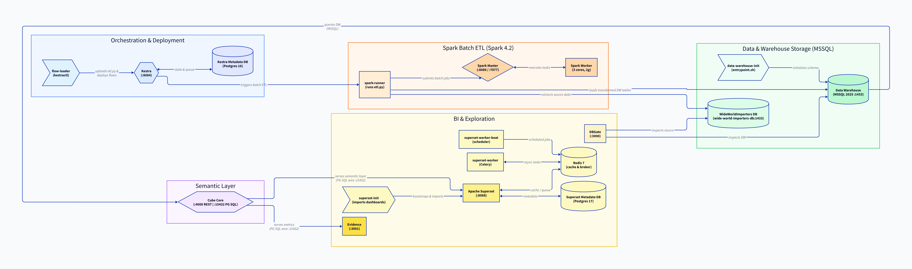
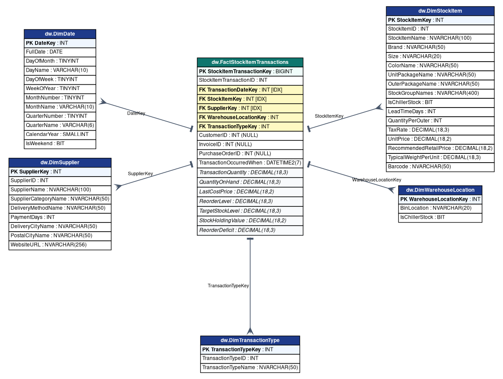
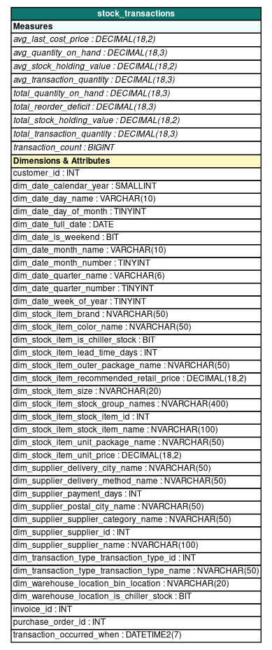

# WideWorldImporters Data Warehouse & ETL Pipeline

An end-to-end data engineering and analytics platform built around the **WideWorldImporters** dataset. It combines **Kestra** orchestration, **Apache Spark** batch ETL (`WideWorldImporters-etl`), **Microsoft SQL Server** dimensional data warehousing, **Cube core** semantic layer, and **Apache Superset**, **Evidence**, and **DBGate** for BI and database exploration.

---

## Installation & Setup

### 1. Configure Environment Variables

Copy the environment templates and fill in your passwords, usernames, and secrets (such as `MSSQL_SA_PASSWORD`, `KESTRA_DB_*`, `KESTRA_ADMIN_*`, `CUBE_SQL_*`, and `EVIDENCE_BASIC_*`):

```bash
cp .env.example .env
cp docker/superset/.env.example docker/superset/.env

```

### 2. Build and Start the Stack

Start all services in detached mode using Docker Compose:

```bash
docker compose up --build -d

```

---

## Service UIs & Endpoints

Once the containers are up and healthy, you can access the following web UIs and endpoints locally:

| Service | URL | Purpose |
| --- | --- | --- |
| **DBGate** | http://localhost:3000 | Web SQL client connected to `wide-world-importers-db` and `data-warehouse` |
| **Evidence** | http://localhost:3001 | Code-based inventory & supply chain analytics dashboard (`my-inventory-dashboard`) |
| **Cube** | http://localhost:4000 | Semantic layer API / playground (PostgreSQL wire protocol on port `15432`) |
| **Spark Master** | http://localhost:8080 | Apache Spark cluster UI and worker status |
| **Spark Worker** | http://localhost:8081 | Spark worker web UI (3 cores, 2g memory) |
| **Kestra** | http://localhost:8084 | Workflow orchestration UI (`data.pipelines` namespace & flows) |
| **Apache Superset** | http://localhost:8088 | BI dashboards & exploration UI (pre-configured with `wwi.zip` dashboard import)

 |

---

## ETL Pipeline Architecture

### 1. End-to-End Pipeline



* **Orchestration & Deployment:** `flow-loader` (`kestractl`) uploads `WideWorldImporters-etl/src/etl.py` and deploys flows from `flows/` (such as `spark-itl.yaml`) into **Kestra** (`:8084`), which persists state and queues in **PostgreSQL 16**.


* **Spark Batch ETL (Spark 4.2):** Kestra triggers batch ETL jobs via `spark-runner` against the **Spark Master** (`:8080` / `:7077`) and **Spark Worker** (`:8081`).


* **Data & Warehouse Storage (MSSQL):** `wide-world-importers-db` provides the source OLTP database, while `data-warehouse` (MSSQL 2025) is initialized by `data-warehouse-init` (`docker/dw/entrypoint.sh` & `schema.sql`) and populated with transformed warehouse tables.


* **Semantic Layer:** **Cube Core** (`:4000` REST, `:15432` Postgres SQL wire) models metrics and dimensions from the SQL Server data warehouse using definitions in `model/cubes/` and `model/views/`.


* **BI & Exploration:** **Apache Superset** (`:8088`, backed by Postgres 17, Redis 7, Celery worker/beat, and `superset-init`) and **Evidence** (`:3001`) query the semantic layer, while **DBGate** (`:3000`) provides direct database inspection.


### 2. Star Schema Data Warehouse



* **Fact Table:** `dw.FactStockItemTransactions` (`PK StockItemTransactionKey`), storing transaction quantities, `QuantityOnHand`, `LastCostPrice`, `ReorderLevel`, `TargetStockLevel`, `StockHoldingValue`, `ReorderDeficit`, and foreign keys to dimensions.


* **Dimensions:**
* `dw.DimDate` (`PK DateKey`) — calendar attributes (`FullDate`, `MonthName`, `QuarterName`, `CalendarYear`, `IsWeekend`, etc.).


* `dw.DimStockItem` (`PK StockItemKey`) — item details (`StockItemName`, `Brand`, `Size`, `ColorName`, `StockGroupNames`, `IsChillerStock`, `LeadTimeDays`, pricing, etc.).


* `dw.DimSupplier` (`PK SupplierKey`) — supplier metadata (`SupplierName`, `SupplierCategoryName`, `DeliveryMethodName`, `PaymentDays`, city info, etc.).


* `dw.DimWarehouseLocation` (`PK WarehouseLocationKey`) — bin location and chiller status.


* `dw.DimTransactionType` (`PK TransactionTypeKey`) — transaction type ID and name.


### 3. Semantic Layer View



* **Exposed View (`stock_transactions`):** Flattens the star schema into a single analytical interface defined in `model/views/stock_transactions.yml`.


* **Measures:** Aggregations such as `transaction_count`, `total_transaction_quantity`, `avg_transaction_quantity`, `total_quantity_on_hand`, `avg_quantity_on_hand`, `total_stock_holding_value`, `avg_stock_holding_value`, `avg_last_cost_price`, and `total_reorder_deficit`.


* **Dimensions & Attributes:** Prefixed dimension fields (e.g., `dim_date_*`, `dim_stock_item_*`, `dim_supplier_*`, `dim_warehouse_location_*`, `dim_transaction_type_*`) alongside transaction identifiers and timestamps (`customer_id`, `invoice_id`, `purchase_order_id`, `transaction_occurred_when`).


---

## Repository Structure

* `docker/` — Dockerfiles, initialization scripts.


* `flows/` — Kestra workflow definitions (e.g., `spark-itl.yaml`).


* `graph/` — Architecture and schema diagrams (`.d2`, `.dot`, and `.png` files).


* `model/` — Cube semantic layer cubes (`model/cubes/*.yml`) and views (`model/views/stock_transactions.yml`).


* `my-inventory-dashboard/` — Evidence analytics project and Markdown report pages.


* `superset-dashboards/` — Pre-packaged Superset dashboard archive (`wwi.zip`) imported on startup.


* `test/` — SQL seed and cleanup scripts (`seed_wwi.sql`, `cleanup_wwi.sql`).


* `WideWorldImporters-etl/` — ETL codebase.


* `docker-compose.yaml` & `superset.yaml` — Multi-service container definitions and shared `etl` Docker network.


---
